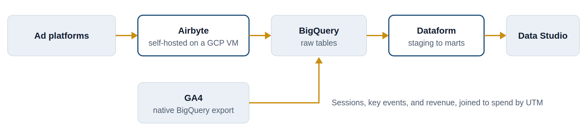
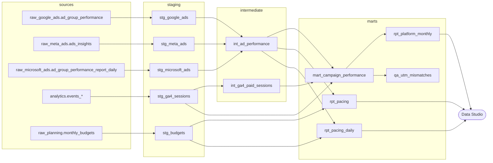

# Ad reporting in Dataform

A Dataform project that joins ad spend from Google Ads, Meta, and Microsoft Ads to GA4 sessions, key events, and revenue in BigQuery, one row per day per ad group, and tracks spend against monthly budgets. It feeds three Data Studio pages: pacing for media buyers, performance for reporting teams, and tracking QA for analytics.

It's a public, synthetic-data version of a pipeline I built, where self-hosted Airbyte on Google Cloud loads the ad platforms into BigQuery, GA4 exports there directly, and Dataform models both for a Data Studio dashboard. The client, Northwind Outdoor Co., is fictional, and every number comes from `scripts/generate_data.py`.



*The production pipeline this sample mirrors. This repo is the Dataform layer, with synthetic data loaded straight into BigQuery in place of Airbyte.*

## How it fits together



Staging gives every platform the same columns. `int_ad_performance` stacks the platforms; `int_ga4_paid_sessions` maps GA4 traffic to the platform that paid for it. `mart_campaign_performance` joins the two at date × platform × campaign × ad group. `rpt_pacing` and `rpt_pacing_daily` compare spend to date with each campaign's monthly budget.

## The problems it handles

| Problem | How it's handled |
|---|---|
| The GA4 export only starts on the day it was linked (2 Feb 2026 here). Ad data goes back to October, so earlier months would show spend with zero sessions. | The final table starts on the first day of GA4 data, found with `MIN(session_date)` rather than a hard-coded date. |
| Spend only lines up with GA4 when campaigns and ad groups are tagged consistently in `utm_campaign` and `utm_content`. | The join uses lowercased, trimmed names, and every row gets a `match_status`: `matched`, `spend_only`, or `sessions_only`. |
| One Meta ad set's ads still carry an old `utm_content` (`Lookalike_Carousel_v1`). | `qa_utm_mismatches` lists it twice, as about $6,000 of spend with no sessions and about 5,400 sessions with no spend. Nothing is silently dropped. |
| Meta traffic arrives as `utm_source` facebook, fb, or ig; Microsoft lowercases campaign names in its UTMs. | One mapping in `includes/constants.js` turns source and medium into a platform, and the name normalization handles case. |
| Google Ads reports cost in micros, Meta sends spend as a string, and Microsoft uses PascalCase columns. | Each staging model converts its platform to the shared columns. |
| Airbyte re-syncs recent days, and Meta restates them. | Staging keeps only the latest sync of each ad set-day. |
| Pacing needs every dollar of spend, but the GA4-joined table starts in February. | The pacing models read the combined ad data directly, include spend with no budget, and project month-end spend at the current daily rate. The sample data stops on 18 June, so June shows one campaign over pace and one under. |
| Platforms report more conversions than GA4 records key events. | Both are kept side by side. `rpt_platform_monthly.platform_to_ga4_ratio` shows the gap: about 1.7 for Meta here, and about 1.2 for search. |

## Checks

- **Built-in assertions on every model:** unique keys at each model's grain, non-null keys, `spend >= 0`, and `clicks <= impressions`.
- **`assert_combined_spend_matches_staging`:** stacking the platforms neither drops nor double-counts spend.
- **`assert_pacing_spend_matches`:** the pacing table holds every dollar of ad spend, budgeted or not.
- **`assert_mart_matches_inputs`:** the full outer join keeps exactly the ad spend and exactly the paid GA4 sessions from the GA4 start date on.
- **`test_rpt_platform_monthly` (unit test):** pins cost per key event as total spend ÷ total key events. $100 for 1 key event plus $100 for 9 is $20, not the $55.56 you'd get by averaging daily values.

## Run it

### On your laptop, no cloud account

You need Python 3.10+ and Node.js 18+.

```bash
pip install -r requirements.txt
npm install -g @dataform/cli@3.0.70
python scripts/run_local.py --export
```

The runner generates the synthetic data, compiles the project with the Dataform CLI, loads the raw data into a local DuckDB file, and builds every model in dependency order. Then it runs every assertion and the unit test, and it ends with `12 models built, 20 of 20 checks passed.` With `--export`, it also writes `data/ad-reporting-dashboard-data.xlsx`, one tab per dashboard table, ready for Google Sheets and Data Studio.

To build locally, the runner translates the compiled BigQuery SQL to DuckDB with [sqlglot](https://github.com/tobymao/sqlglot). In BigQuery, the same compiled SQL runs unchanged.

GitHub Actions runs the same command on every push (`.github/workflows/test.yml`), so a change that breaks a model or a check fails the build.

### In BigQuery

1. Generate and load the data. BigQuery's free sandbox is enough for the loads and queries.
   ```bash
   python scripts/generate_data.py
   pip install google-cloud-bigquery
   gcloud auth application-default login
   python scripts/load_to_bigquery.py --project your-gcp-project-id
   ```
2. Set `defaultProject` in `workflow_settings.yaml` to your GCP project.
3. Run it in the Google Cloud console: create a Dataform repository, connect it to this GitHub repo, and choose **Start execution → All actions**. Or use the CLI:
   ```bash
   dataform init-creds        # writes .df-credentials.json (git-ignored)
   dataform run               # builds every model and runs the assertions
   dataform test              # runs the unit test
   ```

If Dataform won't execute in a sandbox project, enable billing. This dataset is small enough to stay within BigQuery's free tier.

## Layout

```
definitions/sources/       declarations for the raw tables, the budget table, and the GA4 export
definitions/staging/       one model per source
definitions/intermediate/  ad platforms combined; GA4 paid sessions mapped to platforms
definitions/marts/         the daily table, monthly report, UTM mismatch check, and budget pacing
definitions/assertions/    reconciliation checks
definitions/tests/         unit test for the monthly KPIs
includes/constants.js      key events, source-to-platform mapping, join-key rule, pacing tolerance
scripts/                   data generator, local runner, and BigQuery loader
.github/workflows/         CI: builds and tests the project on every push
```

## What I'd add next

- Backfill GA4 history before the export date through the GA4 Data API, merged with the export from its start date on.
- Make `mart_campaign_performance` incremental, reprocessing a few recent days to pick up platform restatements.
- Schedule runs with a Dataform workflow configuration and alert on failed assertions.
